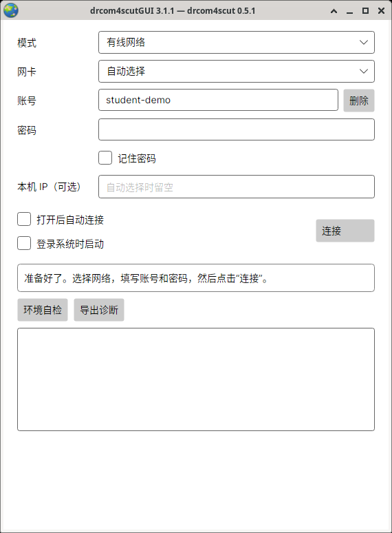

# Linux 桌面安装与连接

[返回首页](../README.md) · [Windows](windows.md) · [Mac](macos.md)

本页以 Ubuntu 24.04 桌面为例。GUI 使用 glibc 和 X11；Wayland 桌面通过 XWayland 显示窗口。无图形桌面的服务器使用[Linux 命令行指南](https://github.com/SeaLoong/drcom4scut/blob/master/docs/linux.md)；OpenWrt 设备使用[路由器指南](https://github.com/SeaLoong/drcom4scut/blob/master/docs/openwrt.md)。

## 1. 下载适合处理器的桌面包

打开终端，运行：

```sh
uname -m
```

按输出，前往[客户端下载页](https://github.com/SeaLoong/drcom4scut/releases)选择最新版本（含预览版），展开 **Assets（文件列表）**。下载文件名含 **`desktop`**，并符合下表的包：

| 输出 | 桌面包文件名结尾 |
| --- | --- |
| `x86_64` | `linux-x64.tar.gz` |
| `aarch64` | `linux-arm64.tar.gz` |

例如：`drcom4scut-desktop-core-0.5.1-gui-3.1.1-linux-x64.tar.gz`。图形界面、命令行核心和运行组件都已包含。

## 2. 解压桌面包

1. 用归档管理器打开压缩包，选择“提取”。
2. 在个人目录创建 `Applications` 文件夹；已经有这个文件夹时直接使用。
3. 在解压结果中找到包含 `drcom4scutGUI` 程序的文件夹，将这个完整文件夹移入 `Applications`，改名为 `drcom4scutGUI`。

最终目录如下：

```text
~/Applications/drcom4scutGUI/
├── drcom4scutGUI           ← 图形界面
├── drcom4scut              ← 同包命令行程序
├── docs/                  ← 窗口操作帮助
├── core-help/docs/        ← 命令行帮助
└── 其他程序文件……
```

GUI 已自带 .NET。Ubuntu 24.04 的图形和中文字体组件可用下面命令准备：

```sh
sudo apt install libx11-6 libice6 libsm6 libxcb1 libxrandr2 libxi6 \
  libxcursor1 libxrender1 libgl1 libfontconfig1 libgtk-3-0t64 \
  libicu74 libssl3t64 fonts-noto-cjk
```

其他发行版安装对应名称的系统包。完整要求见 [Avalonia Linux 说明](https://docs.avaloniaui.net/docs/supported-platforms#desktop-linux)和 [.NET 系统列表](https://github.com/dotnet/core/blob/main/release-notes/10.0/supported-os.md)。

## 3. 准备网络与密码保存

**校园 Wi-Fi：** 在桌面网络菜单连好校园网络，直接进入下一步。

**有线连接：** 插好网线，在终端进入客户端文件夹，给核心授予收发认证报文的权限：

```sh
cd "$HOME/Applications/drcom4scutGUI"
sudo setcap cap_net_raw=ep ./drcom4scut
getcap ./drcom4scut
./drcom4scut doctor
```

`getcap` 应显示 `cap_net_raw=ep`。缺少 `setcap` 命令时，Ubuntu 可先执行 `sudo apt install libcap2-bin`。每次替换核心后重新授权；受管理的电脑由管理员协助设置。

**想要记住密码：** Ubuntu 安装 `libsecret-tools`，并解锁桌面密码库，例如 GNOME Keyring：

```sh
sudo apt install libsecret-tools
```

密码库与该工具一起提供保存功能。也可以保持“记住密码”未勾选，每次输入校园密码。

## 4. 打开窗口并连接



Linux 实际程序截图，使用示例账号，处于连接前状态。


以普通用户打开客户端。在刚才的目录执行：

```sh
./drcom4scutGUI
```

1. 插网线时，模式选“有线网络”，网卡先用“自动选择”；网页登录时选“校园网页认证”，填写学校实际的“登录页地址”。
2. 填写账号和密码；“本机 IP（可选）”通常留空。
3. 点击“环境自检”，按提示确认运行条件。
4. 按需勾选“记住密码”，点击 **“连接”**。

显示“已连接，可以上网了”后即可打开浏览器。Linux 会保留普通窗口；最小化仍保持连接，点击“断开”结束连接，关闭窗口会停止连接并退出程序。

网页登录的适用页面与 HTTP 设置见[校园网页认证](usage.md#无线-portal)。

<details>
<summary>查看 Linux 上的校园网页登录窗口</summary>


图中账号和地址用于展示，密码为空，未发起认证。使用时填写学校当前登录页地址。

</details>

## 常见问题

| 现象 | 处理方法 |
| --- | --- |
| 双击后没有窗口 | 在终端运行 `./drcom4scutGUI` 查看提示，按第二步准备图形组件 |
| 提示无执行权限 | 在客户端目录运行 `chmod u+x ./drcom4scutGUI ./drcom4scut`，再重新打开；有线核心随后重新检查网络权限 |
| 中文显示方框 | 安装中文字体，例如 Ubuntu 的 `fonts-noto-cjk` |
| 有线提示权限不足 | 执行第三步的 `getcap` 和自检；更新核心后重新授权 |
| “记住密码”保存失败 | 确认桌面密码库已解锁、`secret-tool` 可用，或取消勾选后输入密码连接 |
| 想要登录桌面后自动连接 | 勾选“登录系统时启动”“打开后自动连接”，并记住所选账号密码 |

## 使用同包命令行

在客户端目录执行下面命令，即可查看核心的命令行帮助：

```sh
cd "$HOME/Applications/drcom4scutGUI"
./drcom4scut --version
./drcom4scut --help
```

配置与连接步骤见 [Linux 命令行指南](https://github.com/SeaLoong/drcom4scut/blob/master/docs/linux.md)。包内 `core-help/docs/` 也提供离线命令行帮助。图形界面与命令行选择一种方式连接即可。

更多操作：[多账号](usage.md#多账号) · [账号与密码](security.md) · [连接排障](usage.md#排查连接问题)
