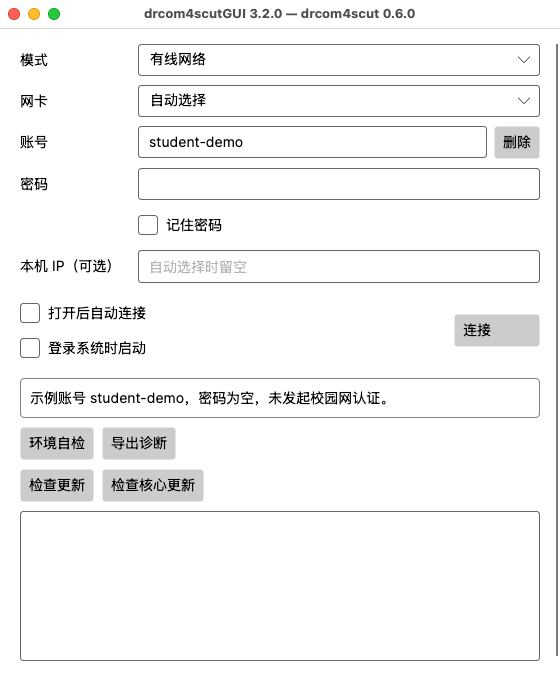
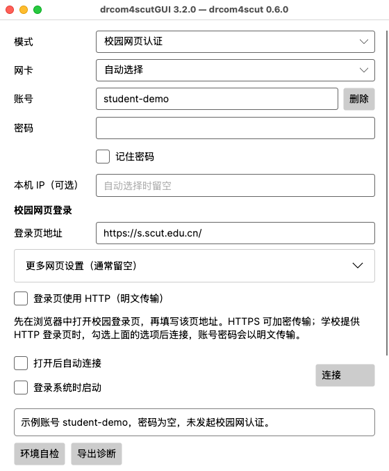

# Mac 安装与连接

[返回首页](../README.md) · [Windows](windows.md) · [Linux](linux.md)

本页介绍 Mac 图形界面的安装和使用。GUI 需要 **macOS 15 或更新且受 .NET 10 支持的版本**；可在 **苹果菜单 → 关于本机** 查看系统版本和芯片。

## 1. 下载适合芯片的桌面包

前往[客户端下载页](https://github.com/SeaLoong/drcom4scut/releases)，选择最新版本（含预览版），展开 **Assets（文件列表）**。下载文件名含 **`desktop`**，并符合下表的压缩包：

| “关于本机”显示 | 桌面包文件名结尾 |
| --- | --- |
| 芯片 Apple M 系列 | `osx-arm64.tar.gz` |
| 处理器 Intel | `osx-x64.tar.gz` |

例如：`drcom4scut-desktop-core-0.5.1-gui-3.1.1-osx-arm64.tar.gz`。一个包已包含图形界面、核心和运行组件，Apple 芯片版本可直接运行。

## 2. 解压桌面包

1. 在访达中双击下载的 `.tar.gz`。
2. 将解压出的完整文件夹移到自己的个人文件夹，按需改名为“校园网客户端”。
3. 打开该文件夹，应用和核心已并排放好。

```text
个人文件夹/校园网客户端/
├── drcom4scutGUI.app       ← 双击打开窗口
├── drcom4scut              ← 同包命令行程序
├── docs/                  ← 窗口操作帮助
└── core-help/docs/        ← 命令行帮助
```

保持 `.app` 完整，并保留旁边的核心。移动安装位置时，将整个文件夹一起移动。

## 3. 完成首次打开

双击 `drcom4scutGUI.app`。当前发布尚未取得 Apple Developer ID 签名和公证，首次打开可能出现来源提示。核对下载来自项目发布页后，在 **系统设置 → 隐私与安全性** 中，按系统提示允许打开这份应用。Apple 的[具体操作说明](https://support.apple.com/guide/mac-help/open-a-mac-app-from-an-unknown-developer-mh40616/mac)可帮助找到对应选项。

核心是另一个程序，也需要 macOS 允许运行。打开“终端”，进入刚创建的文件夹，再检查核心版本：

```sh
cd "$HOME/校园网客户端"
./drcom4scut --version
```

若系统提示核心被阻止，同样到“隐私与安全性”允许这份核心，然后重新运行上述版本命令。看到版本号后，再打开 GUI。

## 4. 准备校园网络

**校园 Wi-Fi：** 在 macOS 的 Wi-Fi 菜单连好校园网络，直接进入下一步。

**有线连接：** 插入网线或 USB / 雷雳网卡，在 **系统设置 → 网络** 确认该网卡已连接。随后打开 GUI，点击“环境自检”。

有线认证需要访问 Mac 的网络报文设备，这项权限称为 **BPF**。自检提示权限不足时，在自己的终端执行：

```sh
sudo chown "$(id -un)" /dev/bpf[0-9]*
sudo chmod u+rw /dev/bpf[0-9]*
```

`sudo` 要求的是 **Mac 管理员密码**。这两条命令让当前用户访问现有 BPF 设备；重启或系统创建新设备后，可按自检提示重新授权。完成后以普通用户打开 GUI，再运行一次“环境自检”。

长期使用可由管理员安装 Wireshark 的 ChmodBPF 权限方案；学校或单位管理的 Mac 沿用管理员设置。细节见[核心 Mac 权限指南](https://github.com/SeaLoong/drcom4scut/blob/master/docs/macos.md#有线抓包权限)。

## 5. 点击连接



macOS 15（Apple 芯片）实际运行截图，使用示例账号，处于连接前状态。


1. 插网线时选“有线网络”，网卡先用“自动选择”；网页登录时选“校园网页认证”，填写学校实际的“登录页地址”。
2. 填写校园账号和密码。“本机 IP（可选）”通常留空。
3. 按需勾选“记住密码”，点击 **“连接”**。

出现“已连接，可以上网了”后即可使用网络。连接成功时窗口可能收起，从屏幕顶部菜单栏的程序图标选择“打开”即可找回。点击“断开”结束连接；关闭窗口或选择“退出”会停止连接并退出程序。

网页登录的适用页面与 HTTP 设置见[校园网页认证](usage.md#无线-portal)。保存密码由当前用户的登录钥匙串保护，提示钥匙串锁定时先解锁，或取消“记住密码”后连接。

<details>
<summary>查看 Mac 上的校园网页登录窗口</summary>



图中账号和地址用于展示，密码为空，未发起认证。使用时填写学校当前登录页地址。

</details>

## 常见问题

| 现象 | 处理方法 |
| --- | --- |
| GUI 能打开但找不到核心 | 确认 `drcom4scut` 位于 `.app` 旁边，再按第三步运行版本命令 |
| 刚换了核心又出现系统提示 | 按“隐私与安全性”提示允许这份新程序，重新查看版本 |
| 重启后有线自检失败 | 查看是否需要重新授权 BPF，按第四步操作 |
| 有线网卡名称不熟悉 | 在“系统设置 → 网络”查看已连接的 USB / 雷雳网卡，再在 GUI 中选对应网卡 |
| 想要开机后自动连接 | 勾选“登录系统时启动”“打开后自动连接”，并记住所选账号密码 |

## 使用同包命令行

打开“终端”，进入解压后的客户端目录即可调用核心：

```sh
cd "$HOME/校园网客户端"
./drcom4scut --help
```

连接步骤见 [Mac 命令行指南](https://github.com/SeaLoong/drcom4scut/blob/master/docs/macos.md#配置与认证)。包内 `core-help/docs/` 也提供离线命令行帮助。图形界面与命令行共用同一份程序，选择一种方式连接即可。

窗口中的“检查更新”和“检查核心更新”可分别更新图形界面与核心；更新界面后会重新打开应用。操作和 Mac 提示示例见[更新程序](update.md#mac)。

更多操作：[多账号](usage.md#多账号) · [账号与密码](security.md) · [连接排障](usage.md#排查连接问题)

系统兼容范围：[.NET 10 支持的 macOS 版本](https://github.com/dotnet/core/blob/main/release-notes/10.0/supported-os.md)。
