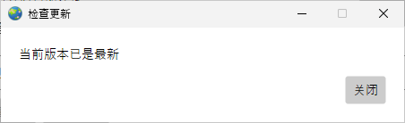
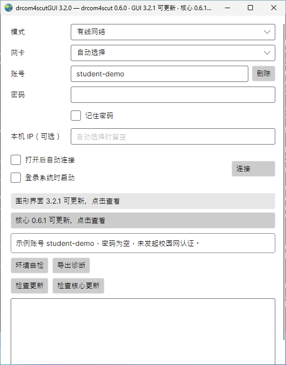
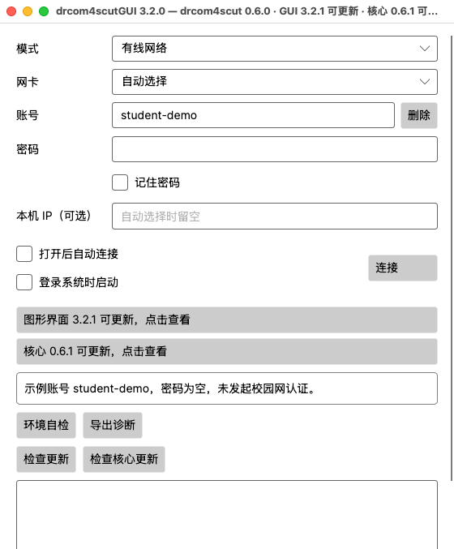
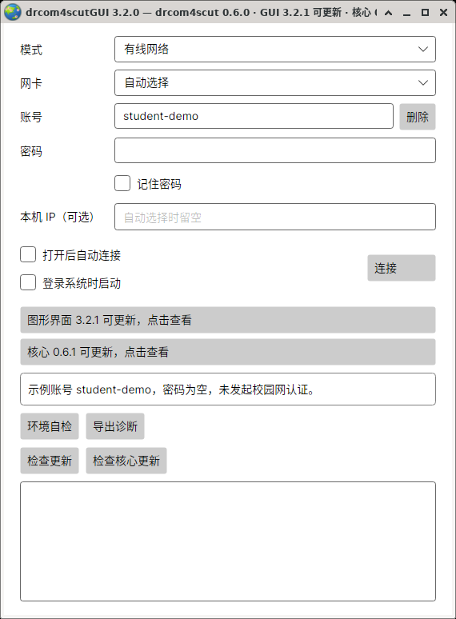
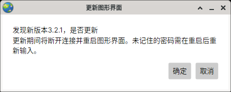

# 更新程序

[返回首页](../README.md) · [日常使用](usage.md)

在窗口中就能更新到**最新正式版**，原来的账号、已记住的密码和网络设置继续保留。更新检查不选择标为 Pre-release 的预览版；检查信息、校验清单和下载文件默认都通过 `https://gh-proxy.com/` 获取。

## 手动检查

在窗口下方选择需要检查的部分：

| 按钮 | 更新什么 |
| --- | --- |
| 检查更新 | 图形界面 |
| 检查核心更新 | 负责校园网连接的核心 |

已是最新时会显示“当前版本已是最新”。发现新版时，窗口会显示版本并询问是否更新；确认后自动下载、校验和安装。



Windows 实际窗口：手动检查后的结果。

## 看到新版本提示后

第一次完整连接成功后，窗口等待 60 秒自动检查，以后每 24 小时检查一次。断线重连不会重新计时。没有新版或暂时无法检查时不弹窗；发现新版时，标题和窗口内会显示相应版本。

点击“图形界面 … 可更新，点击查看”或“核心 … 可更新，点击查看”，确认后开始安装。图形界面和核心分别检查、分别更新，可按需要依次处理。

### Windows



Windows 实际窗口，更新版本号为演示数据。

### Mac



Mac 实际窗口，更新版本号为演示数据。

### Linux



Linux 实际窗口，更新版本号为演示数据。

## 更新时的连接与重启

| 更新的部分 | 会发生什么 |
| --- | --- |
| 核心 | 下载完成后短暂断开，安装并验证新版，再恢复原来正在使用的连接；本次输入的密码继续用于这次连接 |
| 图形界面 | 下载完成后注销连接并退出，安装新版后重新打开；按原来的“打开后自动连接”设置启动，未记住的密码需重新输入 |

更新图形界面时保留已有核心。Mac 会更新完整的 `.app`。Linux 核心已有有线网卡权限时，可能弹出系统授权窗口，请按提示确认；取消授权或恢复权限失败时会还原原核心。

安装期间连接按钮保持不可用，完成或失败后恢复。若提示另一个更新正在进行，请等待它完成后重试，避免同时从 GUI 和终端安装。



Linux 实际确认窗口，更新版本号为演示数据。

## 检查或更新未完成

手动检查失败会显示“检查更新失败”，确认网络可用后再试。安装失败时按提示处理，必要时重新连接后再更新。安装目录应允许当前用户写入；也可以按[安装指南](usage.md#安装和系统要求)重新下载完整桌面包。

## 更换更新代理

默认使用 `https://gh-proxy.com/`，通常无需创建额外文件。需要更换时，在[账号配置所在目录](security.md#保存了哪些内容)创建 `updates.json`，只填写：

```json
{
  "proxyUrl": "https://gh-proxy.com/"
}
```

将示例地址换成自己信任的 HTTPS 代理前缀，保留末尾的 `/`，不含用户名、密码、查询参数或 `#` 片段。这个文件只设置更新网络，不填写校园账号密码。保存后重新检查即可。

在终端运行核心的用户，可看[核心更新命令与自动提醒设置](https://github.com/SeaLoong/drcom4scut/blob/master/docs/update.md)。
