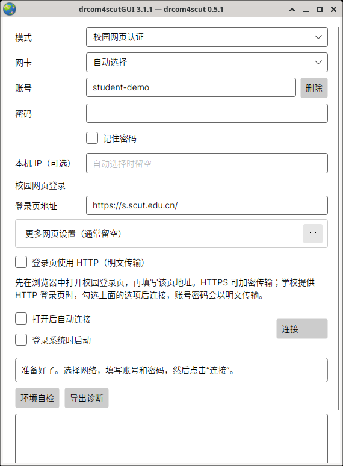

# 安装与日常使用

[返回首页](../README.md)

首次安装请选择下方的系统指南；已经能打开窗口时，直接看[有线连接](#有线认证)或[校园网页认证](#无线-portal)。本页还提供多账号、自动连接和排障说明。

## 安装和系统要求

下载一个 **桌面一体包** 即可：图形界面、认证核心和运行组件都已放好。完整解压后，可以打开窗口，也可以在同一目录使用命令行。

| 你的系统 | 完整安装步骤 |
| --- | --- |
| Windows | [选处理器 → 解压桌面包 → 有线时安装 Npcap → 连接](windows.md) |
| macOS | [选芯片 → 解压桌面包 → 首次打开 → 有线授权 → 连接](macos.md) |
| Linux 桌面 | [选架构 → 准备图形组件 → 核心授权 → 密码库 → 连接](linux.md) |

各页都包含实际文件摆放位置、首次打开和连接失败后的处理。下表供已经熟悉安装过程的用户快速核对下载文件。

### 下载哪一个桌面包

图形界面和命令行共用同一个桌面包。在[下载页](https://github.com/SeaLoong/drcom4scut/releases)选择最新版本（含预览版），展开 **Assets（文件列表）**，找到文件名含 **`desktop`** 的压缩包。

Windows 在“设置 → 系统 → 关于”查看系统类型；Mac 在“苹果菜单 → 关于本机”查看芯片。Linux 终端运行 `uname -m`：`x86_64` 选 x64，`aarch64` 选 ARM64。

| 电脑 | 桌面包的文件名结尾 | 解压后打开 |
| --- | --- | --- |
| Windows，Intel / AMD | `win-x64.zip` | `drcom4scutGUI.exe` |
| Windows，ARM64 | `win-arm64.zip` | `drcom4scutGUI.exe` |
| Mac，Intel | `osx-x64.tar.gz` | `drcom4scutGUI.app` |
| Mac，Apple 芯片 | `osx-arm64.tar.gz` | `drcom4scutGUI.app` |
| Linux，Intel / AMD | `linux-x64.tar.gz` | `drcom4scutGUI` |
| Linux，ARM64 | `linux-arm64.tar.gz` | `drcom4scutGUI` |

例如，Windows x64 的文件名形如 `drcom4scut-desktop-core-0.5.1-gui-3.1.1-win-x64.zip`。保留解压出的完整文件夹；`Source code` 是开发用源码。

需要检查下载完整性时，可将压缩包的 SHA-256 与同一发布页 `SHA256SUMS` 中对应的值比较：Windows 用 `Get-FileHash 文件名 -Algorithm SHA256`，Mac 用 `shasum -a 256 文件名`，Linux 用 `sha256sum 文件名`。

### Windows

查看 [Windows 安装与连接](windows.md)。解压桌面包，有线连接准备 Npcap，随后双击 `drcom4scutGUI.exe`。

### macOS

查看 [Mac 安装与连接](macos.md)。解压后应用与核心已并排放好，首次分别允许运行；有线连接完成 BPF 授权。

### Linux

查看 [Linux 桌面安装与连接](linux.md)。解压桌面包，准备系统图形组件；有线权限授予核心，窗口以普通用户运行。

## 有线认证

1. 插好网线，确认系统的有线连接已启用。
2. 模式选择“有线网络”，填写校园账号和密码，包括学校要求的账号后缀。
3. 网卡先用“自动选择”；需要指定时，选插着校园网线的以太网卡。“本机 IP（可选）”通常留空。
4. 按需勾选“记住密码”，点击“连接”。

窗口先显示“正在连接校园网”，再显示“账号已通过验证，正在确认连接”。出现“已连接，可以上网了”后即可使用网络；断线时会显示“正在自动重连”。

“有线网络（仅 802.1X）”用于学校只要求身份认证的特殊网络。华工常规有线连接使用默认的“有线网络”。

## 无线 Portal

### 这与浏览器登录有什么关系

无线使用顺序仍然是：**连接校园 Wi-Fi → 打开学校网页 → 输入账号密码登录。** 客户端的“校园网页认证”代为提交受支持的 DrCOM/ePortal 网页请求，并查询当前设备的在线状态。Wi-Fi 连接由系统完成。

这项功能参考了公开校园客户端，已通过模拟服务测试，实际校园使用情况仍待验证。需要验证码、短信、扫码或统一身份认证跳转的页面，继续使用浏览器即可。实现来源见[参考记录](https://github.com/SeaLoong/drcom4scut/blob/master/docs/references-clients.md)。

### 使用校园网页认证

Linux 实际运行截图：示例账号、空密码，尚未发起认证。图中地址用于展示输入位置，使用时填写学校当前登录页地址。

1. 在系统中连接校园 Wi-Fi，确认平时的校园登录页能正常打开。
2. 在客户端选择“校园网页认证”，填写账号和密码。
3. 将学校**尚未提交账号密码的登录页地址**填入“登录页地址”。“本机 IP（可选）”和“更多网页设置”通常留空。
4. 点击“连接”，等待学校确认当前设备在线。

优先使用学校提供的 `https://` 地址，账号密码会加密传输。学校只提供 `http://` 时，可核对入口后勾选“登录页使用 HTTP（明文传输）”；这会将账号密码明文发送到学校服务器。[了解传输与密码保存](security.md#无线门户与密码传输)。

点击“断开”会请求注销并停止重连。如需同时关闭学校的设备自动登录，请在校园网页中管理绑定和自动登录选项。

### 浏览器能用，程序不能用怎么办

先用浏览器完成登录，再检查客户端日志中的错误信息。常见原因是学校页面流程不同、入口地址变化，或账号后缀需要调整。

求助时附上客户端版本、校区、错误信息和学校公开登录页地址。诊断文本的分享方法见[导出和分享诊断](security.md#导出和分享诊断)。

### 高级：无线地址字段

这些字段位于“更多网页设置”，通常保持空白，由核心自动查询。学校或排障人员提供了明确数值后，再按下表填写。

| 字段 | 用途 |
| --- | --- |
| 登录页地址 | 平时在浏览器打开的学校登录入口 |
| API 地址 | 学校网页提交请求的后台地址，与入口保持同一主机 |
| AC IPv4 | 校园接入设备的地址 |
| 载荷 IPv4 | 学校登录系统识别的本机地址 |
| 本机 IP（可选） | 电脑实际发出请求时使用的本地地址 |

经过路由器时，学校看到的设备地址可能与电脑地址不同。前者用于登录数据，后者用于选择网络出口。

## 多账号

| 想做什么 | 操作 |
| --- | --- |
| 添加账号 | 输入新账号和密码，点击“连接” |
| 切换账号 | 先“断开”，从账号下拉框选择另一个账号，再“连接” |
| 修改密码 | 选中账号，填写新密码，按需勾选“记住密码”，再“连接” |
| 删除本机记录 | 先“断开”，选中账号，点击“删除”并确认 |

每个账号分别设置“记住密码”。取消勾选仍会保存账号和网络设置，下次填写密码即可使用。本机记录与学校账号独立；学校密码在学校账号管理入口修改。

## 托盘、停止和退出

Windows 的右下角托盘、Mac 的顶部菜单栏都有程序图标。连接成功后，图标可用时窗口会收起；从图标菜单选择“打开”即可找回。Linux 保留普通窗口。

| 操作 | 结果 |
| --- | --- |
| 最小化或收起窗口 | 继续保持连接 |
| 点击“断开” | 注销本次连接并停止重连 |
| 关闭窗口或选择菜单“退出” | 停止连接并退出程序 |

连接中断时可打开窗口查看恢复进度，程序会继续尝试连接。

## 自动启动和自动认证

| 选项 | 作用 |
| --- | --- |
| 登录系统时启动 | 下次登录电脑时打开客户端 |
| 打开后自动连接 | 打开客户端后使用已选账号连接 |

想要登录电脑后自动上网，勾选这两项，并记住所选账号的密码。设置针对当前系统用户生效。移动程序文件夹后，重新设置启动选项即可更新位置。

## 排查连接问题

先点击“环境自检”，再按报告检查。自检负责确认电脑的运行条件；连接时窗口会继续显示学校的认证结果。

| 遇到的情况 | 处理方法 |
| --- | --- |
| 找不到核心或版本不兼容 | 按[下载对应表](#下载哪一个核心包)重新完整解压对应系统的桌面包，保留全部文件 |
| Mac 核心无法启动 | 在终端运行 `./drcom4scut --version`，完成系统允许后再试 |
| 有线环境自检未通过 | Windows 检查 Npcap；Mac、Linux 按安装步骤完成核心授权，再核对网卡 |
| 填好账号仍连接失败 | 核对账号后缀、密码、网线与所选网卡，查看窗口下方的学校返回信息 |
| 浏览器能登录，校园网页认证失败 | 使用浏览器上网，并按[无线说明](#无线-portal)核对入口与页面类型 |
| 密码无法保存 | 解锁系统密码库，或取消“记住密码”后输入密码连接 |
| Linux 中文显示方框 | 安装中文字体，如 Ubuntu 的 `fonts-noto-cjk` |
| 窗口找不到了 | 从 Windows 托盘或 Mac 菜单栏图标选择“打开” |

需要进一步帮助时，“导出诊断”并附上系统、版本、校区、操作经过，以及问题发生前是否切换 Wi-Fi、VPN、网线或从睡眠恢复。分享前按[诊断说明](security.md#导出和分享诊断)检查私人信息。

## 高级：核心配置

额外的核心选项放在 GUI [配置目录](security.md#保存了哪些内容)中的 `core.yml`，修改前先断开连接。字段参考[核心配置说明](https://github.com/SeaLoong/drcom4scut/blob/master/docs/configuration.md)；账号密码由窗口提供。

`profile` 是有线报文兼容选项，默认 `legacy`，正常使用保持默认即可。它与 Windows、Mac 或 Linux 无关。窗口选择的连接方式、HTTP 许可和地址会优先传给核心。
