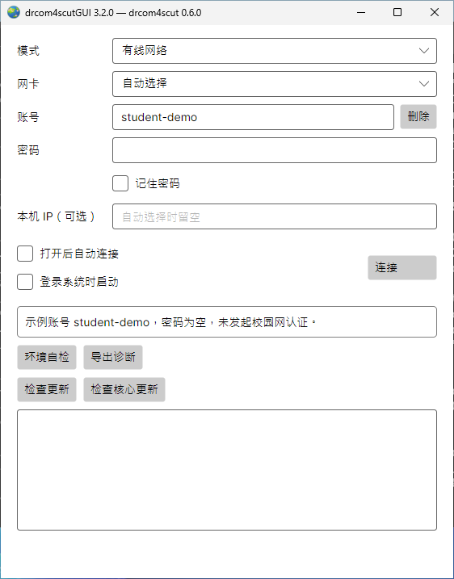
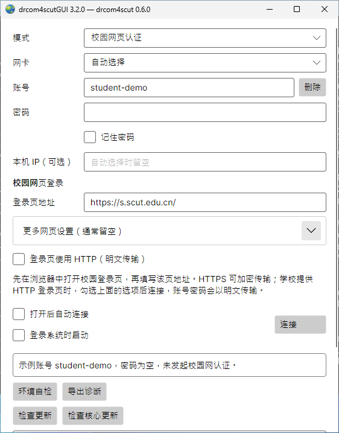

# Windows 安装与连接

[返回首页](../README.md) · [Mac](macos.md) · [Linux](linux.md)

本页适合使用 Windows 桌面的同学，推荐受支持的 Windows 11。安装完成后，在窗口里填写校园账号即可连接，无需另装 .NET。

## 1. 下载桌面包

先打开 **设置 → 系统 → 关于**，查看“系统类型”。前往[客户端下载页](https://github.com/SeaLoong/drcom4scut/releases)，选择最新版本（含预览版），展开 **Assets（文件列表）**。找到文件名含 **`desktop`**，并符合下表的 ZIP：

| 系统类型 | 桌面包文件名结尾 |
| --- | --- |
| 基于 x64 的处理器，包括 Intel、AMD | `win-x64.zip` |
| 基于 ARM 的处理器 | `win-arm64.zip` |

例如：`drcom4scut-desktop-core-0.5.1-gui-3.1.1-win-x64.zip`。一个包已包含界面、核心和运行组件。

## 2. 解压到自己的文件夹

1. 右键下载的 ZIP，选择“全部解压”。
2. 在解压结果中找到包含 `drcom4scutGUI.exe` 的文件夹，将这个完整文件夹移到“文档”，按需改名为“校园网客户端”。
3. 打开“校园网客户端”，找到 `drcom4scutGUI.exe`。

程序已按下面的方式放好：

```text
文档\校园网客户端\
├── drcom4scutGUI.exe       ← 双击这个打开窗口
├── drcom4scut.exe          ← 同包命令行程序
├── docs\                  ← 窗口操作帮助
├── core-help\docs\        ← 命令行帮助
└── 其他程序文件……
```

保留完整文件夹，以后移动客户端时一起移动。

## 3. 打开客户端

**插网线上网：** 先安装 [Npcap](https://npcap.com/#download)，按安装程序提示完成，然后插好校园网线。Npcap 让核心能够收发有线认证报文。

**校园 Wi-Fi：** 先在 Windows 网络菜单连接校园无线网络；使用网页认证可以直接继续。

双击 `drcom4scutGUI.exe`，以普通用户运行。首次打开时，窗口会检查旁边的核心；看到“准备好了”即可操作。若 Windows 提示文件来源，先核对下载来自上述项目发布页，再按系统提示处理。

## 4. 连接校园网



Windows 实际运行的程序内容区，使用示例账号，处于连接前状态。


| 使用方式 | 窗口里怎么填 |
| --- | --- |
| 插网线 | “模式”选“有线网络”；“网卡”先选“自动选择”；填写账号、密码 |
| 连 Wi-Fi 后网页登录 | “模式”选“校园网页认证”；填写账号、密码，以及平时使用的学校“登录页地址” |

“本机 IP（可选）”通常留空。按需勾选“记住密码”，点击 **“连接”**。

显示“已连接，可以上网了”后，即可打开浏览器使用网络。窗口收起时，在 Windows 右下角托盘找到程序图标，从菜单选择“打开”。点击“断开”结束连接；关闭窗口或菜单“退出”会停止连接并退出。

网页登录的适用页面与 HTTP 设置见[校园网页认证](usage.md#无线-portal)。使用扫码、验证码等网页时，直接在浏览器完成登录。

<details>
<summary>查看 Windows 上的校园网页登录界面</summary>



图中账号和地址用于展示，密码为空，未发起认证。使用时填写学校当前登录页地址。

</details>

## 常见问题

| 现象 | 处理方法 |
| --- | --- |
| 找不到核心 | 检查 `drcom4scut.exe` 是否与 `drcom4scutGUI.exe` 在同一个目录；可在资源管理器打开文件扩展名显示后核对名称 |
| 提示版本或系统不匹配 | 按第一步的系统类型选择对应桌面包，重新完整解压 |
| 有线无法访问网卡 | 点击“环境自检”，检查 Npcap 是否安装完成、网线和网卡是否启用；受管理的电脑由管理员协助授权 |
| 有多张网卡 | “网卡”改选实际插校园网线的以太网卡，再连接 |
| 想要开机后自动连接 | 选好账号、记住密码，勾选“登录系统时启动”和“打开后自动连接” |
| 需要提供排障信息 | 点击“导出诊断”，按[分享说明](security.md#导出和分享诊断)处理后附上 Windows 版本和操作经过 |

## 使用同包命令行

在客户端文件夹的空白处右键，选择“在终端中打开”，可以直接调用包内核心：

```powershell
.\drcom4scut.exe --version
.\drcom4scut.exe --help
```

需要用命令行连接时，按 [Windows 命令行指南](https://github.com/SeaLoong/drcom4scut/blob/master/docs/windows.md)填写配置并运行。包内 `core-help/docs/` 也提供离线命令行帮助。图形界面与命令行选择一种方式连接即可。

窗口中的“检查更新”和“检查核心更新”可分别更新图形界面与核心。操作和 Windows 提示示例见[更新程序](update.md#windows)。

更多操作：[多账号](usage.md#多账号) · [账号与密码](security.md) · [全部常见问题](usage.md#排查连接问题)
